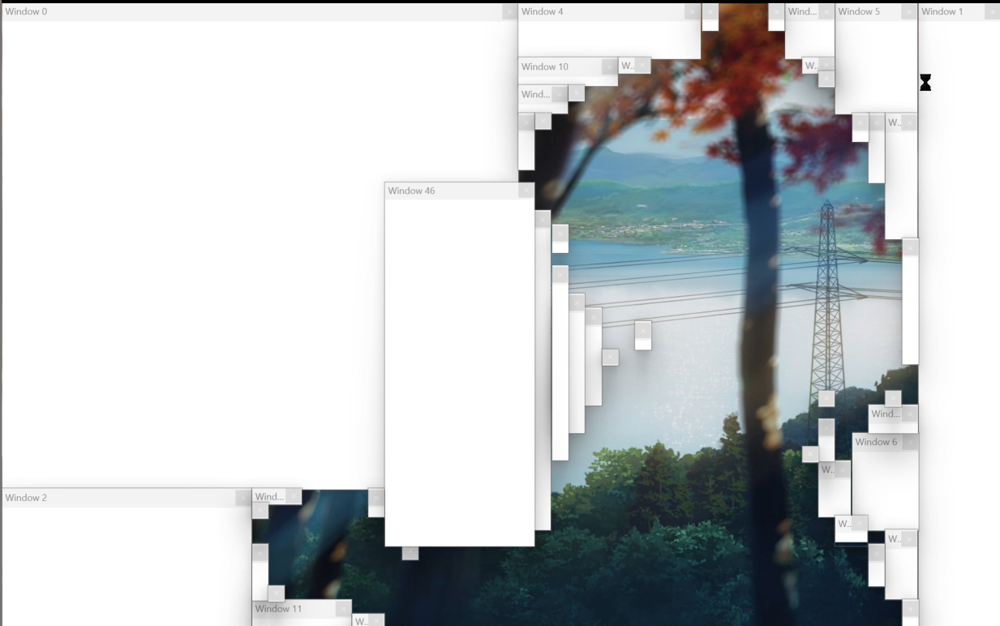

# Bad Apple but it's a Windows virus
This is very much inspired by the original repository [bad_apple_virus](https://github.com/mon/bad_apple_virus#bad-apple-but-its-a-windows-virus) by [mon](https://github.com/mon).

Originally written in Rust, I made it in C++.

The original project is licensed under the MIT License.

## How to build it yourself
If you use my files, make sure you have the correct libraries and just
`g++ Main.cpp res.o -o BadApple.exe -std=c++17 -mwindows -static -ldwmapi -lgdi32 -luser32 -lwinmm`.

To make your own files, 
1. Run the python program to get a json file.
2. Convert your video to a .wav.
3. Change the values in the code.
4. Create a .rc file, and `windres Badapple.rc -O coff -o res.o`, for a file to attach the resources to the exe.
5. Then `g++ Main.cpp res.o -o BadApple.exe -std=c++17 -mwindows -static -ldwmapi -lgdi32 -luser32 -lwinmm`, and run your exe file.

